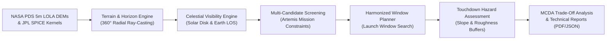

<div align="center">

# 🌕 LUNAVISTA
### Lunar Mission Architecture & Scientific Analysis Platform
**Precision Landing Site Screening, Terrain Horizon Profiling & Celestial Visibility Engine**

[](https://lunavista.exenoz.in/)
[](https://lunavista-api-2026-c5htd5h5d0bmd2gf.centralindia-01.azurewebsites.net/docs)
[](https://pds-geosciences.wustl.edu/)
[](https://naif.jpl.nasa.gov/)

<br />

```
===================================================================================
🚀 HACKATHON JUDGES & REVIEWERS — ACCESS THE LIVE DEPLOYED PLATFORM HERE:
👉👉👉  https://lunavista.exenoz.in/  👈👈👈
===================================================================================
```

*Built for Artemis-era lunar surface architectures, crewed landing site assessments, and robotic surface survival planning.*

</div>

---

## 🔭 Executive Overview

**LUNAVISTA** is a mission-grade lunar exploration and landing site selection platform engineered to solve the most critical challenges of lunar south pole exploration: **extreme terrain slopes**, **grazing solar illumination**, **long cryogenic darkness periods**, and **Earth communication line-of-sight (LOS) blackouts**.

Unlike speculative AI ranking tools, LUNAVISTA operates on **deterministic physical models and verified NASA planetary datasets**:
- **High-Resolution NASA LOLA 5 m/px DEMs** (PDS Product 78) across South Pole candidate sites: Connecting Ridge (Site 01), de Gerlache Rim (Site 04), and Amundsen Rim (Site 11).
- **Sub-Pixel Ray-Marched Horizon Skyline Engine**: 360° radial topocentric obstruction profiles computed directly against 5 m digital elevation rasters.
- **Finite Celestial Disk Visibility**: Numerically integrates partial solar disk grazing, full illumination, and total eclipse with zero arbitrary assumptions ($Full + Partial + Dark = 100.00\%$).
- **JPL NAIF SPICE Planetary Ephemerides**: Rigorous topocentric Sun and Earth elevation/azimuth using DE440s/DE421 kernels.
- **Rule-Based Mission Screening & MCDA Trade-off Engine**: Pareto-frontier candidate analysis with auditable scientific provenance.

---

## 🌐 Live Deployments & Endpoints

| Service | Environment | Provider | URL |
| :--- | :--- | :--- | :--- |
| **Frontend Web App** | Production | Vercel Global Edge | [**https://lunavista.exenoz.in/**](https://lunavista.exenoz.in/) |
| **Scientific REST API** | Production | Microsoft Azure App Service | [**API Documentation (Swagger)**](https://lunavista-api-2026-c5htd5h5d0bmd2gf.centralindia-01.azurewebsites.net/docs) |
| **System Health Check** | Production | Azure Cloud | [**Health Telemetry**](https://lunavista-api-2026-c5htd5h5d0bmd2gf.centralindia-01.azurewebsites.net/health) |

---

## 🧭 Key Capabilities & Scientific Workflow



### 1. 2D Map & 3D Interactive Terrain Explorer
- Full-fidelity interactive 3D surface mesh generation powered by Three.js and WebGL.
- NASA Moon Trek WMTS orthomosaic basemaps synchronized in real time with high-resolution digital elevation overlays.
- Dynamic elevation transect profiling, slope gradient heatmaps, and customizable hillshade azimuth/altitude visualization.

### 2. 360° Topocentric Horizon Profiler
- Evaluates radial lines-of-sight out to the regional boundary at 0.5°–1.0° azimuth steps.
- Accounts for lunar spherical curvature, receiver mast eye-height ($+2.0\text{ m}$ to $+10.0\text{ m}$), and local surface relief.

### 3. Solar & Earth Visibility Integration
- Distinguishes **Full Sunlight**, **Partial Grazing Illumination**, and **Darkness** by treating the Sun not as a point source, but as an apparent $0.53^\circ$ finite celestial disk.
- Calculates time-weighted solar disk exposure fraction to evaluate solar panel energy harvesting capacity.
- Evaluates direct-to-Earth communication windows and continuous blackout spans.

### 4. Multi-Candidate Screening & Mission Window Planning
- Simultaneously screens candidate landing sites against mission constraint envelopes (Maximum allowable slope, Minimum continuous solar hours, Earth LOS requirements).
- **Harmonized Comparison**: Enforces shared epoch baselines to eliminate seasonal solar elevation bias between candidates.

### 5. Touchdown Hazard Assessment
- Evaluates circular landing buffer zones (50 m, 100 m, 250 m radius).
- Computes surface roughness, peak-to-peak relief, and safe landing gear clearance probabilities.

### 6. Multi-Criteria Trade-Off Analysis (MCDA)
- Deterministic weighted scoring with interactive sensitivity sliders.
- Automated Pareto-frontier identification: isolates mathematically non-dominated landing locations.
- One-click export of formal technical evaluation reports (JSON & printable audit records).

---

## 🎯 Hackathon Judge Demo Scenarios

Experience the platform's multi-site capabilities directly on [lunavista.exenoz.in](https://lunavista.exenoz.in/):

| Scenario | Candidate Site | Region | Coordinates | Profile / Outcome | Key Scientific Observation |
| :--- | :--- | :--- | :--- | :--- | :--- |
| **Optimal Base** | `DG Crater Rim Crest` | Site 04 (de Gerlache) | `88.7100° S, 68.7000° E` | **PASS (100% Score)** | Ridge elevation provides continuous Earth visibility and low slopes ($<8^\circ$). |
| **Grazing Solar** | `Connecting Ridge Crest` | Site 01 (Shackleton) | `89.4387° S, -137.0865° E` | **PARTIAL (38% Solar Flux)** | Sun grazes the skyline; 95.8% partial disk illumination without full disk clearance. |
| **Hazardous Crater** | `Connecting Ridge South` | Site 01 (Shackleton) | `89.5800° S, -135.5000° E` | **FAIL (Exceeds Limits)** | Steep terrain shadows cause extended cryogenic darkness ($>72\text{ h}$) and excessive slope ($>15^\circ$). |

---

## 🏗️ Architecture & Technology Stack

- **Frontend Application**:
  - React 18 & TypeScript
  - Three.js & `@react-three/fiber` for 3D lunar terrain rendering
  - OpenLayers for NASA Moon Trek WMTS geospatial projection & cartography
  - Tailwind CSS & Lucide Icons
  - Deployed on **Vercel** with HTTPS edge routing
- **Scientific Backend Engine**:
  - FastAPI (Python 3.11) with Uvicorn / Gunicorn production server
  - **Rasterio & GDAL**: High-speed GeoTIFF reading and spatial bounding-box clipping
  - **SpiceyPy & CSPICE**: Planetary ephemerides using JPL DE440s kernels
  - **NumPy & SciPy**: Ray-marching, numerical integration, and spatial statistics
  - Deployed on **Microsoft Azure App Service** (Linux B1)

---

## 💻 Local Development Setup

### Prerequisites
- Node.js 20+ and npm
- Python 3.11+
- Git

### 1. Clone Repository
```bash
git clone https://github.com/Niyasmc47/LunarExenos2026.git
cd LunarExenos2026
```

### 2. Backend Setup
```bash
cd backend
python -m venv venv
source venv/bin/activate  # On Windows: venv\Scripts\activate
pip install -r requirements.txt

# Run backend development server
python -m uvicorn app.main:app --host 127.0.0.1 --port 8000 --reload
```
Interactive API docs will be available at `http://127.0.0.1:8000/docs`.

### 3. Frontend Setup
In a new terminal:
```bash
npm install
npm run dev
```
Open `http://localhost:5173` in your browser.

### 4. Running the Test Suite
```bash
# Backend unit & scientific invariant tests (148 tests)
PYTHONPATH=backend pytest backend/tests

# Frontend TypeScript check and production build
npm run build
```

---

## 📜 Scientific Datasets & Citations

1. **NASA Lunar Reconnaissance Orbiter (LRO)**
   - *LOLA (Lunar Orbiter Laser Altimeter)*: 5 m/pixel Polar Digital Elevation Model (DEM) tiles (PDS Product 78).
   - *LROC (Lunar Reconnaissance Orbiter Camera)*: WAC Global Basemap & Moon Trek Tile Service.
2. **NASA / JPL NAIF SPICE Ephemeris System**
   - Planetary ephemeris kernel: `de440s.bsp`
   - Leapseconds kernel: `naif0012.tls`
   - Planetary constants kernel: `pck00010.tpc`

---

<div align="center">

**Developed with precision for the NASA Space Apps / Artemis Challenge**  
*“From a place on the Moon to a mission with a plan.”*

[**Launch LUNAVISTA (https://lunavista.exenoz.in/)**](https://lunavista.exenoz.in/)

</div>
